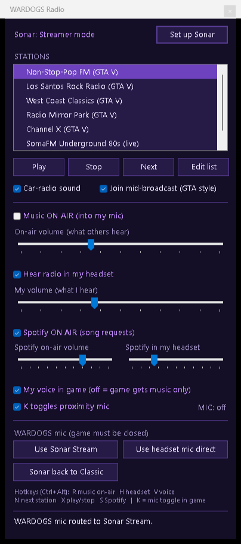

# WARDOGS Radio

Play GTA-style radio stations (or your Spotify) **through your in-game mic** in [WARDOGS](https://store.steampowered.com/search/?term=wardogs), so everyone in proximity chat gets a soundtrack while you fly. Your voice stays separate for Discord.

A small always-on-top Windows GUI built on **SteelSeries Sonar**'s Streamer mode. No virtual-cable installs needed if you already use Sonar.



## Features

- **Station list.** GTA V stations (Non-Stop-Pop FM, Los Santos Rock Radio, West Coast Classics, Radio Mirror Park, Channel X) pulled from YouTube full-station uploads, plus live internet radio. Edit `stations.json` to add your own.
- **"Join mid-broadcast".** Starts long station uploads at a random point, like tuning in to a radio in GTA.
- **Car-radio sound.** An optional band-pass and compressor filter.
- **Music ON AIR** toggle and volume (what others hear), and **Hear radio in my headset** toggle and volume (what you hear). These are independent, so you can broadcast the radio while listening to something else.
- **Spotify ON AIR** for song requests. Spotify gets its own lane, with separate "on-air" and "in my headset" sliders. Keep Spotify's own volume at **100%** and set the levels in the GUI: Sonar can only turn a source down, so a quiet Spotify means a quiet broadcast.
- **My voice in game.** Turn it off and the game gets music only, while you talk on Discord.
- **K toggles proximity mic.** Tap K to go live and tap again to stop. This only applies while the WARDOGS window is focused. You get beeps and a LIVE indicator.
- **Global hotkeys (Ctrl+Alt+…).** R music on-air, H headset, V voice, N next station, X play/stop, S Spotify.
- **Auto-launch.** An optional watcher opens the GUI when WARDOGS starts. The GUI closes itself (and cleans up) when the game exits.

## How it works

```
Radio (ffplay) ──┐
Spotify (opt.) ──┼─► Sonar "Media" ──┬─► Stream mix ──► "Sonar - Stream" mic ──► WARDOGS voice chat
Your voice ──────┼───────────────────┘
                 │
Game, Discord ───┴─► Personal mix ──► your headphones (+ Media, if "hear radio" is on)
```

Sonar's Streamer mode builds a second mix and exposes it as a recording device. The script talks to Sonar's local HTTP API to:

- put only **Mic + Media** in that stream mix (game sound and Discord never leak into it),
- route the radio player and Spotify to the Media channel,
- route WARDOGS's mic input to the Stream device. WARDOGS's voice chat uses the Windows default mic regardless of its own menu setting, so the script overrides it per-app.

## Requirements

- Windows 10/11, Windows PowerShell 5.1 (built in)
- [SteelSeries GG](https://steelseries.com/gg) with **Sonar** enabled
- [FFmpeg](https://ffmpeg.org/) (for `ffplay`): `winget install Gyan.FFmpeg`
- [yt-dlp](https://github.com/yt-dlp/yt-dlp) (for YouTube stations): `winget install yt-dlp.yt-dlp`

## Setup

1. Clone or download this repo anywhere.
2. Run **`Launch WardogsRadio.cmd`**.
3. Click **Set up Sonar**. This switches Sonar to Streamer mode and configures the mixes. Your current headset and mic are detected automatically, so do this while Sonar is in Classic mode the first time.
4. Pick a station, press **Play**, and tick **Music ON AIR**.
5. In WARDOGS, use proximity chat (hold K, or tap K with the toggle enabled).

**Optional auto-launch:** put a shortcut to `WardogsRadioWatcher.ps1` in your Startup folder (`Win+R` → `shell:startup`) with this target:

```
powershell.exe -NoProfile -WindowStyle Hidden -ExecutionPolicy Bypass -File "C:\path\to\WardogsRadioWatcher.ps1"
```

**Going back to normal:** click **Sonar back to Classic**. While Sonar is in Classic mode the Stream mic doesn't exist, so the game's mic routing returns to normal.

## Notes and caveats

- **Etiquette:** proximity chat reaches everyone nearby, enemies included. Keep the on-air volume reasonable. **Ctrl+Alt+R** is your kill switch.
- **The K toggle** uses a keyboard hook and a simulated held key. WARDOGS's anti-cheat isn't publicly documented, so use it at your own risk. Untick it to go back to normal hold-to-talk. Typing a `k` in text chat also flips it.
- **The in-game mic test** plays back the mic input regardless of push-to-talk, so it can't confirm whether you're transmitting.
- **Content:** stations stream from public YouTube uploads and internet radio at play time. Nothing is downloaded or redistributed. Respect the rights of the music owners and the platforms' terms.
- The Sonar API is unofficial and undocumented, and a GG update could change it. Route names come from the excellent [DataNext27/SteelSeries-NET-API](https://github.com/DataNext27/SteelSeries-NET-API).

Not affiliated with SteelSeries, Rockstar Games or the WARDOGS developers.

## License

MIT
